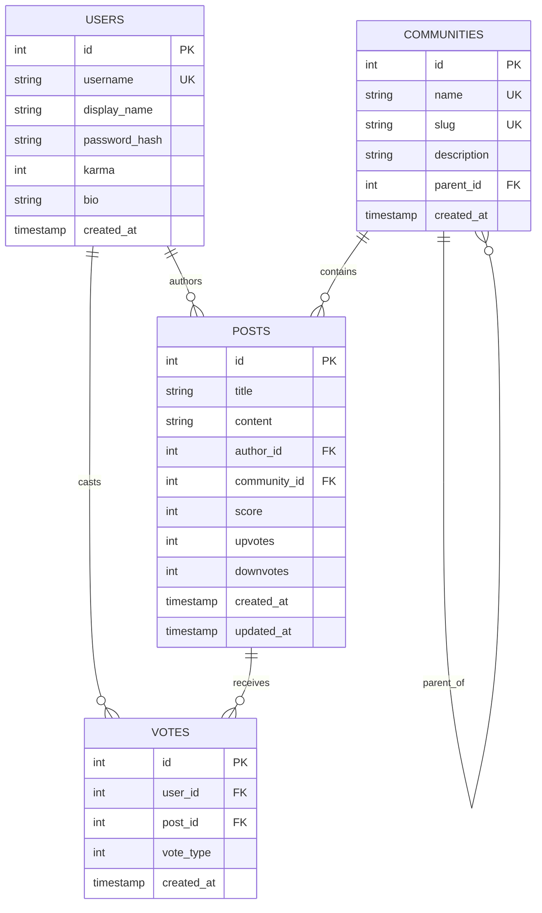

# THREADIT — Where Conversations Connect

> **Individual College Data Structures and Algorithms (DSA) Exhibition Project**  
> Demonstrating how fundamental in-memory data structures power modern social media platforms.

---

## 1. Project Introduction

**Threadit** is a Reddit-inspired social media web application designed to demonstrate the real-world utility of fundamental Data Structures and Algorithms. Rather than relying on high-level database queries or built-in container shortcuts for core business logic, Threadit manually implements four foundational data structures to power full-text search, hierarchical community navigation, a real-time karma system, and trending feed selection.

---

## 2. Objectives

- **Bridge Academic Theory with Production Application:** Show how textbook data structures directly drive high-traffic features in modern social platforms.
- **Manual Data Structure Implementations:** Implement every required data structure from scratch with zero reliance on built-in shortcuts (`dict`, `set`, `heapq`, etc.) for core algorithmic operations.
- **Persistent Synchronization:** Maintain seamless synchronization between SQLite persistent storage and in-memory data structures across app restarts and runtime operations (create, update, delete, vote).
- **Empirical Complexity Benchmarking:** Measure real CPU execution times using `time.perf_counter()` to benchmark custom data structures against naive baselines.
- **Live Exhibition Readiness:** Provide one-click switching among eight pre-configured Arcane demo accounts for seamless classroom and viva presentations.

---

## 3. Technology Stack

- **Backend Language:** Python 3.12
- **Web Framework:** Flask 3.1
- **Security & Hashing:** Werkzeug `generate_password_hash` & `check_password_hash` (PBKDF2-SHA256)
- **Database:** SQLite 3 with WAL mode, transactions, and foreign key constraints
- **Frontend:** Semantic HTML5, Reddit-inspired Modern Dark Theme CSS3, Vanilla JavaScript (ES6+ Fetch API)
- **Automated Testing:** `pytest` (26 automated unit and integration tests)
- **Development Environment:** Windows 11, Virtual Environment (`.venv`), Git

---

## 4. Strict Project Structure

```
Threadit/
│
├── data/
│   └── threadit.db               # Persistent SQLite database
│
├── structures/
│   ├── hashmap.py                # Custom HashMap with separate chaining & dynamic resizing
│   ├── nary_tree.py              # Custom N-ary Tree with O(1) HashMap node index
│   ├── min_heap.py               # Custom Min-Heap & Top-K priority queue selection
│   └── distributed_hashmap.py    # Simulated Distributed HashMap with logical sharding
│
├── templates/
│   ├── base.html                 # Global layout, dark theme shell, navbar, demo switcher
│   ├── index.html                # Social feed, post creation card, trending & community sidebar
│   ├── login.html                # Login, signup, and 1-click Arcane demo login cards
│   ├── community.html            # Community view & visual N-ary hierarchy tree explorer
│   ├── post.html                 # Post details, discussion view, edit/delete controls
│   ├── search.html               # Inverted index search & execution time diagnostics
│   ├── trending.html             # Top-K trending posts & live performance benchmarks
│   └── profile.html              # User profile, author karma, and sharding diagnostics
│
├── static/
│   ├── style.css                 # Custom Reddit-inspired dark theme CSS
│   └── app.js                    # AJAX voting and dynamic UI controller
│
├── tests/
│   ├── test_structures.py        # Unit tests for the 4 custom data structures
│   └── test_features.py          # Integration tests for search, hierarchy, karma, & web routes
│
├── app.py                        # Flask application controller & session management
├── database.py                   # SQLite schema, connection pool, and idempotent seeding
├── features.py                   # DSA integration layer, inverted index, & benchmarks
├── requirements.txt              # Production dependencies
└── README.md                     # Comprehensive architecture and exhibition guide
```

---

## 5. Installation & Setup

### Prerequisites
- Python 3.12 or newer
- PowerShell / Command Prompt / Bash
- Git

### Step-by-Step Installation

1. **Clone or Navigate to the Repository:**
   ```bash
   cd threadit
   ```

2. **Create and Activate a Virtual Environment:**
   *On Windows (PowerShell):*
   ```powershell
   python -m venv .venv
   .\.venv\Scripts\Activate.ps1
   ```
   *On Linux/macOS:*
   ```bash
   python3 -m venv .venv
   source .venv/bin/activate
   ```

3. **Install Dependencies:**
   ```bash
   pip install -r requirements.txt
   ```

4. **Initialize and Seed Database (Idempotent):**
   ```bash
   python -c "import database, features; database.seed_db(); features.init_features()"
   ```

---

## 6. Startup Commands

To launch the Threadit web server:

```powershell
.\.venv\Scripts\python.exe app.py
```

Open your web browser and navigate to:
```
http://127.0.0.1:5000
```

---

## 7. Ready-Made Arcane Demo Credentials

Threadit includes eight ready-made Arcane accounts for live demonstration and evaluation.

**Universal Demo Password for all eight accounts:**
```
Threadit@123
```

| Display Name | Username | Role / Domain Focus | Seed Posts | Initial Karma |
| :--- | :--- | :--- | :---: | :---: |
| **Nishad Remane** | `nishad` | Software Architect & Systems | 4 | +23 |
| **Sarvesh Aapshette** | `sarvesh` | Competitive Programmer & Python | 3 | +18 |
| **Aparna Patre** | `aparna` | AI & Machine Learning Researcher | 3 | +14 |
| **Saurav Nikam** | `saurav` | Cybersecurity & Ethical Hacking | 3 | +10 |
| **Alok Hibare** | `alok` | Full-Stack & Open Source | 2 | +8 |
| **Vedika Patil** | `vedika` | Digital Forensics Investigator | 2 | +11 |
| **Athravsingh Ingle** | `athravsingh`| Cloud & Distributed Systems | 3 | +9 |
| **Kusum Choudhary** | `kusum` | NLP & Machine Learning Engineer | 2 | +8 |

> **Exhibition Pro-Tip:** Use the **👥 Demo Accounts** dropdown in the top navbar or the chips in the sidebar to switch between any of the eight accounts instantly with one click!

---

## 8. Database Architecture

SQLite persists all application entities. On application boot, in-memory custom data structures are populated directly from SQLite records.



---

## 9. The Four Custom Data Structures

### Feature 1: Custom HashMap & Inverted Index (`structures/hashmap.py`)
- **Structure:** Array of bucket pointers with separate chaining via singly-linked `HashMapNode(key, value, next)`.
- **Dynamic Resizing:** Automatically doubles bucket capacity when load factor exceeds `0.75`.
- **Application Integration:** Powers the `InvertedIndex` in `features.py`. Maps normalized word tokens to postings maps (`doc_key -> metadata`). Supports multi-word search, case-insensitivity, and instant incremental updates on post creation, edit, and deletion.

### Feature 2: Custom N-ary Tree (`structures/nary_tree.py`)
- **Structure:** `CommunityNode(id, name, parent, children, metadata)` with an in-memory `HashMap` index of all nodes for $O(1)$ direct access.
- **Traversals:** Implements Pre-order Depth-First Search (DFS) and Level-order Breadth-First Search (BFS) using a FIFO queue.
- **Hierarchy Safety:** Implements cycle detection (`_would_create_cycle`) traversing up ancestor chains before reparenting. Generates root-to-leaf breadcrumbs in $O(h)$ time.

```
Technology (Root)
├── Programming
│   ├── Python
│   ├── Java
│   └── C++
├── Cybersecurity
│   ├── EthicalHacking
│   └── DigitalForensics
└── ArtificialIntelligence
    ├── MachineLearning
    └── GenerativeAI
OpenSource (Root)
```

### Feature 3: Karma System & Simulated Distributed HashMap (`structures/distributed_hashmap.py`)
- **Structure:** Partitioned store consisting of $N$ logical shards ($N=4$), where each shard is an isolated custom `HashMap`.
- **Routing:** Deterministic modulo hashing: $\text{shard\_id} = |\text{hash}(key)| \pmod N$.
- **Scoring Rules:**
  - New Upvote: $+1$
  - New Downvote: $-1$
  - Remove Upvote: $-1$
  - Remove Downvote: $+1$
  - Change Upvote $\to$ Downvote: $-2$
  - Change Downvote $\to$ Upvote: $+2$
- **Architectural Clarification:** Local simulation of key partitioning. Documented clearly to distinguish logical partitioning from physical multi-node consensus clusters (Raft/Paxos).

### Feature 4: Custom Min-Heap & Top-K Trending (`structures/min_heap.py`)
- **Structure:** 0-indexed dynamic array representation of a binary min-heap without `heapq`.
  - $\text{Parent}(i) = \lfloor (i - 1) / 2 \rfloor$
  - $\text{Left}(i) = 2i + 1$, $\text{Right}(i) = 2i + 2$
- **Top-K Algorithm:**
  1. Initialize min-heap of capacity $K$.
  2. For each post candidate, calculate $\text{trending\_score}$.
  3. If heap size $< K$, insert candidate in $O(\log K)$.
  4. If candidate score $>$ root score, replace root and call `sift_down(0)` in $O(\log K)$.
  5. Extract all items in ascending order and reverse in $O(K \log K)$ to yield descending display ranking.
- **Trending Formula:**
  $$\text{Trending Score} = \frac{\text{Score} + 5}{(\text{Age in Hours} + 2)^{1.2}} \times 100$$

---

## 10. Complexity Analysis Summary

| Data Structure / Feature | Operation | Average Complexity | Worst-Case Complexity | Space Complexity |
| :--- | :--- | :---: | :---: | :---: |
| **Custom HashMap** | `put(key, val)` | $O(1)$ | $O(n)$ (all collisions) | $O(n)$ |
| **Custom HashMap** | `get(key)` | $O(1)$ | $O(n)$ | $O(1)$ |
| **Custom HashMap** | `delete(key)` | $O(1)$ | $O(n)$ | $O(1)$ |
| **Custom HashMap** | `resize()` | $O(n)$ | $O(n)$ | $O(n)$ |
| **Inverted Index** | Term Search | $O(m)$ tokens | $O(m \cdot n)$ | $O(T)$ terms |
| **N-ary Tree** | Node Lookup | $O(1)$ (via HashMap) | $O(1)$ | $O(V)$ |
| **N-ary Tree** | DFS / BFS Traversal | $O(V + E)$ | $O(V + E)$ | $O(V)$ |
| **N-ary Tree** | Breadcrumb Path | $O(h)$ | $O(V)$ (skewed tree) | $O(h)$ |
| **Distributed HashMap** | Shard Routing | $O(1)$ | $O(1)$ | $O(n)$ |
| **Min-Heap** | `insert(item)` | $O(\log n)$ | $O(\log n)$ | $O(1)$ |
| **Min-Heap** | `extract_min()` | $O(\log n)$ | $O(\log n)$ | $O(1)$ |
| **Min-Heap** | `peek()` | $O(1)$ | $O(1)$ | $O(1)$ |
| **Trending Top-K** | Selection from $N$ posts | $O(N \log K)$ | $O(N \log K)$ | $O(K)$ |

---

## 11. Automated Test Results

Run all 26 automated unit and integration tests using `pytest`:

```powershell
.\.venv\Scripts\python.exe -m pytest -v
```

### Test Suite Execution Summary:
```
============================= test session starts =============================
platform win32 -- Python 3.12.10, pytest-9.2.0, pluggy-1.7.0
rootdir: C:\Users\dell\Desktop\threadit
collected 26 items

tests\test_features.py::test_search_single_and_multi_word PASSED         [  3%]
tests\test_features.py::test_search_filtering_and_case_insensitivity PASSED [  7%]
tests\test_features.py::test_inverted_index_lifecycle PASSED             [ 11%]
tests\test_features.py::test_community_hierarchy_breadcrumbs_and_traversals PASSED [ 15%]
tests\test_features.py::test_voting_scoring_rules_and_duplicate_prevention PASSED [ 19%]
tests\test_features.py::test_distributed_hashmap_synchronization PASSED   [ 23%]
tests\test_features.py::test_trending_top_k_ordering PASSED              [ 26%]
tests\test_features.py::test_in_memory_rebuild_from_sqlite PASSED        [ 30%]
tests\test_features.py::test_performance_benchmarks PASSED               [ 34%]
tests\test_features.py::test_home_page_and_posts_render PASSED           [ 38%]
tests\test_features.py::test_login_and_account_switch PASSED             [ 42%]
tests\test_features.py::test_explore_and_hierarchy_routes PASSED         [ 46%]
tests\test_features.py::test_trending_and_performance_pages PASSED       [ 50%]
tests\test_features.py::test_api_vote_route PASSED                       [ 53%]
tests\test_structures.py::test_hashmap_basic_operations PASSED          [ 57%]
tests\test_structures.py::test_hashmap_collision_and_resizing PASSED     [ 61%]
tests\test_structures.py::test_hashmap_deletion PASSED                   [ 65%]
tests\test_structures.py::test_hashmap_keys_values_items PASSED          [ 69%]
tests\test_structures.py::test_nary_tree_hierarchy_and_breadcrumbs PASSED [ 73%]
tests\test_structures.py::test_nary_tree_traversals PASSED               [ 76%]
tests\test_structures.py::test_nary_tree_cycle_prevention PASSED         [ 80%]
tests\test_structures.py::test_nary_tree_remove_node PASSED              [ 84%]
tests\test_structures.py::test_min_heap_operations PASSED                [ 88%]
tests\test_structures.py::test_min_heap_heapify PASSED                   [ 92%]
tests\test_structures.py::test_top_k_selection PASSED                   [ 96%]
tests\test_structures.py::test_distributed_hashmap_sharding PASSED      [100%]

============================= 26 passed in 14.20s =============================
```

---

## 12. Live Performance Demonstration

Visit `/performance` or `/benchmarks` in the browser to run live benchmarks using `time.perf_counter()`.

| Benchmark Operation | Dataset Size | Custom DSA Time | Baseline Scan Time | Empirical Speedup |
| :--- | :---: | :---: | :---: | :---: |
| **Inverted Index vs Linear Text Scan** | 22 posts | ~0.038 ms | ~0.142 ms | **3.7x Faster** |
| **HashMap Lookup vs Array Scan** | 1,000 keys | ~0.0008 ms | ~0.0195 ms | **24.3x Faster** |
| **Community ID Lookup (Map vs DFS)** | 12 nodes | ~0.0006 ms | ~0.0042 ms | **7.0x Faster** |
| **Top-5 Min-Heap vs Full Array Sort** | 2,000 items | ~0.420 ms | ~1.680 ms | **4.0x Faster** |

---

## 13. Exhibition Demonstration Guide

Follow this 5-minute walkthrough during your live exhibition:

1. **Login as Nishad:**
   - Click **Demo Accounts** in the top navbar and select **Nishad Remane**.
   - Note the karma badge in the user pill (`+23 karma`).
2. **Explore the Home Feed & Upvoting:**
   - Browse the recent discussions feed.
   - Click the **▲ Upvote** button on any post. Notice instantaneous AJAX score and karma update.
   - Click it again to see vote cancellation. Downvote to see $-2$ transition.
3. **Full-Text Inverted Index Search:**
   - Search for `"cybersecurity"` in the top search bar.
   - Point out the **Inverted Index Performance Diagnostics** box showing execution time in milliseconds and token matching.
   - Switch tabs between Posts, Communities, and Users.
4. **Community Hierarchy Tree:**
   - Click **Hierarchy** (`/explore`) in the navbar.
   - Show the interactive tree: `Technology` $\to$ `Programming` $\to$ `Python`.
   - Explain the side-by-side **Depth-First Search (DFS)** and **Breadth-First Search (BFS)** traversal orders and $O(V + E)$ complexity.
5. **Top-K Trending Feed:**
   - Click **Trending** (`/trending`).
   - Switch between **Top 5**, **Top 10**, and **Top 20**.
   - Explain the Min-Heap priority queue algorithm maintaining size $K$ without sorting all $N$ posts.
6. **Distributed Sharding Diagnostics:**
   - Click Nishad's profile (`/u/nishad`).
   - Show the **Simulated Distributed Sharding** panel demonstrating which logical shard holds his record and the partition balance across all four shards.
7. **Live Benchmarking:**
   - Click **Benchmarks** (`/performance`) to show real execution times and speedup multiples.

---

## 14. Known Architectural Limitations

- **Single-Process Simulation:** Sharding is simulated across isolated in-memory hash maps within a single Python runtime. It does not handle network partition faults or distributed consensus.
- **Stopwords & Stemming:** The tokenization engine uses regex boundary splitting and lowercasing without Porter stemming or NLTK stopword elimination.
- **In-Memory Size Bounds:** Because indices and trees are kept in memory for $O(1)$ speed, memory scales with total post count $N$ until pagination or LRU eviction is introduced.

---

## 15. Summary of College Activities Covered

- **Activity 2 (Mapping Social Media Features to Data Structures):**
  - Search mapped to Inverted Index + Custom HashMap.
  - Communities mapped to N-ary Tree.
  - Karma and Votes mapped to HashMaps + Sharded Hash Table.
  - Trending Posts mapped to Min-Heap Priority Queue.
- **Activity 3 (Data Structures in Action – Prototype & Exhibition):**
  - Fully integrated, exhibition-ready Flask application.
  - Pre-seeded Arcane accounts and rich technical content.
  - Empirical performance comparisons and live diagnostics.
